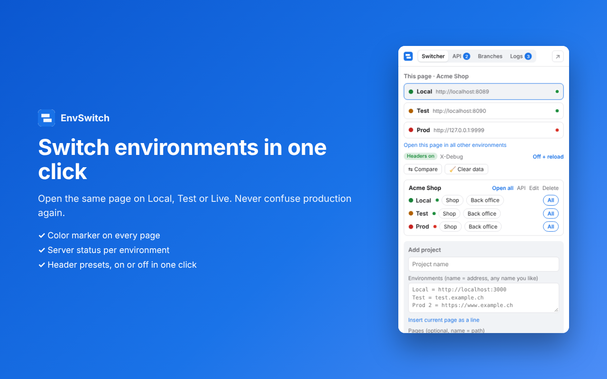

# EnvSwitch

Chrome extension for web developers who work with several environments of the same project (local, test, live).

## Features

- **Switcher** – open the same page on Local, Test or Live in one click, color marker on every page, pages like the back office in all environments as tab groups, protection for Live.
- **Server status** – green/red dot per environment with response time.
- **Header presets** – e.g. `X-Debug: true` or `Authorization: Bearer {{token}}` on every request to an environment, on/off in one click.
- **API tester** – Swagger-style requests and responses, variables per environment, import OpenAPI (auto-detects `/v3/api-docs`), cURL, Postman and HAR, star requests to send them from the popup.
- **Compare** – one request against two environments with field-by-field differences, or the same page side by side.
- **Logs** – JavaScript errors, `console.error` and failed requests of your pages; count on the icon.
- **Record** – capture a page’s API calls and save them as requests.
- **Clear data** – cache, storage, service workers and (optionally) cookies of exactly one environment.
- **Team configuration** – share a project as `.envswitch.json` in your repository; secrets are replaced by variables.
- **Branch Manager** (optional) – git and Mercurial per project: branch, status, pull/push, switch, new branch from a ticket number, recent commits. Needs a small local [helper](helper/README.md).
- English and German.

## Install (development)

1. Download or clone this repository.
2. Open `chrome://extensions`, enable **Developer mode**, click **Load unpacked** and pick the `envswitch` folder.
3. Branch Manager (optional): copy the command from EnvSwitch → Settings and run it, e.g. `npx github:wendelinstadler/envswitch <extension-id>`.

Build the Web Store ZIP: `npm run build` → `dist/envswitch-<version>.zip`.

## Privacy

All data stays on your computer. No analytics, no tracking, no external servers. See [PRIVACY.md](PRIVACY.md).

## License

[MIT](LICENSE)

---

**Deutsch:** EnvSwitch wechselt mit einem Klick zwischen Lokal, Test und Live, testet APIs im Swagger-Stil, sammelt Fehler deiner Seiten und verwaltet git- und hg-Branches pro Projekt. Installieren: `chrome://extensions` → Entwicklermodus → „Entpackte Erweiterung laden“ → Ordner `envswitch`. Die Sprache folgt Chrome und lässt sich in den Einstellungen ändern.
